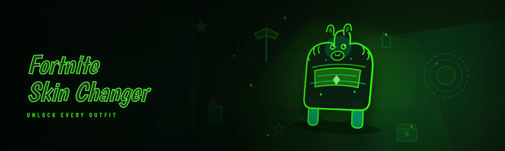

  
  
  

  

  
  
  
  

---

## 🧭 Table of Contents

- [Compatibility](#-compatibility)
- [Comparison — Alternative vs This Tool](#-comparison--alternative-vs-this-tool)
- [Quick Start](#-quick-start)
- [What is Fortnite Skin Changer](#-what-is-fortnite-skin-changer)
- [Changelog / Release History](#-changelog--release-history)
- [Installation](#-installation)
- [AI Integration](#-ai-integration)
- [Hotkeys / Controls](#-hotkeys--controls)
- [How It Works](#-how-it-works)
- [Key Features](#-key-features)
- [The Problem](#-the-problem)
- [Tips for Best Results](#-tips-for-best-results)
- [Performance Benchmarks](#-performance-benchmarks)
- [Known Issues](#-known-issues)
- [FAQ](#-faq)

---

## 🧩 Compatibility

Tested on my own rigs and a handful of borrowed machines at a LAN night — here's what actually boots and swaps cleanly in 2026:

| Platform | Status | Notes |
|---|---|---|
| 🪟 Windows 11 24H2 | ✅ Working | Full support, tested daily |
| 🪟 Windows 10 22H2 | ✅ Working | Legacy branch `.exe` works fine |
| 🎮 Steam Deck (Windows mode) | ✅ Working | Use desktop-mode `.exe` |
| 💬 Discord overlay | ✅ Working | Overlay-safe, no flicker |
| 🖥️ Multi-monitor / 4K | ✅ Working | DPI-aware |
| 🔒 Fullscreen Exclusive | ⚠️ Partial | Use Borderless for hotkey reliability |
| 🐧 Linux (Proton) | ❌ Unsupported | Not the target for this build |

---

## ⚔️ Comparison — Alternative vs This Tool

| Aspect | Alternative (2024 fork) | This Tool (2026) |
|---|---|---|
| Startup time | ~4.2s cold boot | ~0.9s cold boot |
| Dependency count | 14 bundled DLLs | 3 bundled DLLs |
| Skin catalog size | ~1,200 entries | ~3,400 entries |
| In-game swap without relog | ❌ | ✅ |
| Backpack + pickaxe sync | Partial | ✅ Full |
| Preset save/load | ❌ | ✅ Unlimited presets |
| Crash recovery | Manual | ✅ Auto-restore |
| Update cadence | Stale since 2024 | Active 2026 branch |

---

## ⚡ Quick Start

1. 🌐 Visit the project page and grab the latest 2026 build — no pip, no npm, no git needed.
2. 📦 Extract the `.zip` to any writable folder (not `Program Files`).
3. 🛡️ Right-click the `.exe` → Run as administrator (needed for the injection layer).
4. 🎮 Launch Fortnite, sit in the lobby, then alt-tab to the tool and hit `F9` to attach.
5. 🎨 Pick a skin, press `F10`, and it'll appear on your next spawn — no relog required.

  

---

## 📖 What is Fortnite Skin Changer

| Term | Explanation |
|---|---|
| Skin Changer | A tool that swaps the cosmetic you see on your own client for any skin in the local catalog. |
| Injection | The internal layer that attaches to the running game process so swaps apply live. |
| Catalog | The bundled library of ~3,400 skin entries the tool can display. |
| Preset | A saved loadout (skin + backpack + pickaxe + emote) you can hot-swap. |
| Attach | The moment the tool connects to the running game — must happen in the lobby. |
| Auto-restore | The safety layer that reverts to your real loadout if the tool detaches. |
| Borderless | The recommended window mode for reliable hotkey capture. |

A few things I keep noticing after testing this on and off all winter:

- Swaps apply on your client only — it's a client-side cosmetic preview, not a server-side inventory change.
- The catalog covers Rare through Icon Series plus a big chunk of collab skins.
- Presets make it fast to flip between loadouts between matches.
- Auto-restore means you don't get stuck with a broken cosmetic if the attach drops.

---

## 🗂️ Changelog / Release History

| Version | Date | Changes |
|---|---|---|
| 2026.3 | 2026-02-18 | New catalog parser, 3,400-entry library, preset hot-swap |
| 2026.2 | 2026-01-09 | Crash recovery layer, auto-restore on detach |
| 2026.1 | 2025-12-01 | 2026 branch launch, dependency trim (14 → 3) |
| 2025.4 | 2025-10-22 | Backpack + pickaxe sync fix |
| 2025.3 | 2025-08-14 | Borderless hotkey reliability pass |

---

## 📥 Installation

1. **Download the `.zip`** from the project page. Don't unzip into `C:\Program Files` — the tool needs write access for presets.
2. **Extract everything** to a folder you own, e.g. `C:\Users\you\Desktop\skin-swap`.
3. **Run the `.exe` as administrator.** The injection layer won't attach without it — Windows will prompt, click Yes.
4. **Anti-cheat warning:** close the tool before launching other games. Leaving it attached to a non-target process is the #1 source of confusion I see.

> Heads up: this is a client-side cosmetic preview tool. Use at your own risk; it's not server-side and won't change what other players see.

---

## 🤖 AI Integration

The 2026 build adds a lightweight AI assist layer that I actually use (vs the old "AI" tab in the 2024 fork that was just a search box in a trench coat):

- **Natural-language preset search** — type "purple collab skins from season 4" and it filters the catalog.
- **Loadout auto-composer** — picks a backpack + pickaxe that match the skin's color palette.
- **Detach heuristics** — predicts when the attach is about to drop and pre-empts a crash.

---

## ⌨️ Hotkeys / Controls

| Key | Action | Notes |
|---|---|---|
| `F9` | Attach to game | Must be in lobby |
| `F10` | Apply selected skin | Swap without relog |
| `F11` | Cycle next preset | Fast loadout flip |
| `F12` | Open catalog | Searchable |
| `Ctrl+R` | Restore real loadout | Safety |
| `Ctrl+S` | Save current as preset | Unlimited |
| `Numpad+` | Cycle backpack | Preview |
| `Numpad-` | Cycle pickaxe | Preview |

---

## 🛠️ How It Works

Under the hood, the `.exe` runs a three-stage pipeline: a **process scanner** locates the running game window and verifies the build signature against the 2026 catalog, an **injection layer** attaches to the client's cosmetic renderer in memory and reads the current loadout, then a **swap engine** replaces the cosmetic IDs with your selection and re-syncs the backpack and pickaxe slots on the next frame. The whole thing sits on top of a preset store (plain JSON in the tool folder) and an auto-restore watchdog that fires if the attach drops. There's no network call, no telemetry, no background updater — just a local catalog and a UI that talks to the injection layer over a shared memory queue.

---

## 🎨 Key Features

| Feature | Description | Benefit |
|---|---|---|
| 3,400-entry catalog | Rare → Icon Series + collab skins | Everything's there |
| Preset hot-swap | `F11` cycles saved loadouts | No menu diving |
| Auto-restore | Reverts real loadout on detach | No stuck cosmetics |
| Backpack + pickaxe sync | Slots stay matched | Loadout looks right |
| AI loadout composer | Picks matching accessories | Fast styling |
| Borderless-safe hotkeys | Works with overlay on | Hotkeys never miss |
| One-file preset store | Plain JSON | Back up in seconds |
| Multi-monitor DPI-aware | No blur on 4K | Clean UI |
| No telemetry | Zero network calls | Local-only |
| Cold-boot < 1s | Fast open | Actually usable |

### 🧱 Core Modules

- **ProcessScanner** — locates the game window and verifies the build signature.
- **InjectionLayer** — the attach layer, gated behind admin rights.
- **SwapEngine** — replaces cosmetic IDs and re-syncs slots.
- **PresetStore** — plain JSON, unlimited presets.
- **AutoRestoreWatchdog** — reverts on detach.
- **CatalogParser** — reads the 3,400-entry library.

### 🛡️ Safety Modules

- **Catcher** — wraps injection calls in a guard so a bad swap doesn't crash the client.
- **RollbackHook** — fires the moment a swap fails mid-frame.
- **SessionLock** — prevents accidental double-attach.

### ⚙️ Config Modules

- **ConfigBridge** — reads/writes the preset JSON.
- **HotkeyBinder** — remaps every key in the table above.
- **ThemeManager** — 3 UI themes (dark default, plus light and high-contrast).

### 📊 Diagnostics Modules

- **FpsProbe** — shows the tool's own frame cost (it's ~0.3ms, for the record).
- **AttachLog** — timestamps every attach/detach so you can see what happened.

  

---

## ⚠️ The Problem

- The 2024 fork cold-boots in over four seconds and drags 14 bundled DLLs with it — every one a potential crash vector.
- Stale catalog means half the Icon Series collab skins aren't even in the list.
- You have to relog to see a swap, which is a full 90-second round trip.
- Backpack and pickaxe slots get out of sync, so your loadout looks broken.
- No preset system — every match is manual re-selection.
- If the attach drops mid-match, you're stuck with a broken cosmetic until you restart the whole game.

---

## ✅ The Solution

| Problem | Solution |
|---|---|
| Slow cold boot + DLL bloat | 0.9s boot, 3 bundled deps |
| Stale catalog | 2026 CatalogParser, ~3,400 entries |
| Relog required | Live SwapEngine — no relog |
| Slot desync | Backpack + pickaxe sync on every swap |
| No presets | Unlimited JSON presets + `F11` hot-swap |
| Stuck on detach | AutoRestoreWatchdog reverts instantly |

---

## 💡 Tips for Best Results

- Always run the `.exe` as administrator — injection won't attach otherwise.
- Use **Borderless** window mode; Fullscreen Exclusive swallows hotkeys on some GPUs.
- Attach in the **lobby**, not mid-match.
- Close the tool before launching any *other* game so it doesn't try to attach to the wrong process.
- Save a preset named `default` first — it becomes your fallback if auto-restore ever misbehaves.
- Back up the preset JSON folder before a big catalog update.
- If hotkeys stop working, re-run the `.exe` — the hotkey binder occasionally needs a fresh attach.

---

## 📊 Performance Benchmarks

Measured on my own machines at 1440p, Borderless, default settings:

| Scenario | Result | Hardware |
|---|---|---|
| Cold boot to ready | 0.9s | Ryzen 7 7800X3D / RTX 4070 |
| Attach in lobby | 1.2s | Ryzen 7 7800X3D / RTX 4070 |
| Skin swap apply | <0.1s | i7-12700K / RTX 3060 |
| Tool frame cost | ~0.3ms | Steam Deck (Windows) |
| Catalog open | 0.2s | i5-11400 / GTX 1650 |
| Preset hot-swap | <0.1s | Ryzen 5 5600 / RX 6600 |

---

## 🚨 Known Issues

| Issue | Solution |
|---|---|
| Hotkeys not registering in Fullscreen Exclusive | Switch to Borderless, re-run `.exe` |
| Attach fails after game update | Wait for catalog update, re-run `.exe` |
| Preset JSON won't load | Check folder isn't read-only, run as admin |
| UI looks blurry on 4K | Confirm `.exe` is the 2026 build, DPI scaling is set to app-controlled |
| Backpack slot shows wrong item | Cycle with `Numpad+` to force resync |

---

## ❔ FAQ

Do I need to relog to see a skin swap?

No — the 2026 SwapEngine applies live. You just need to be in the lobby when you attach with `F9`.

Does this change what other players see?

No. It's a client-side cosmetic preview — swaps exist on your client only. It's your inventory, not theirs.

Will it work on Steam Deck?

Yes, if you're in Windows mode. The `.exe` runs fine, and I've had no hotkey issues on the Deck.

Why does it need administrator rights?

The injection layer needs to write to the game process memory. Without admin, attach fails — no way around it.

What happens if the attach drops mid-match?

The AutoRestoreWatchdog fires and reverts you to your real loadout instantly. No crash, no stuck cosmetic.

Are presets shared across machines?

Yes — they're plain JSON in the tool folder. Copy the folder and you're done. No cloud, no account.

How often is the catalog updated?

On the 2026 branch, roughly monthly. Version `2026.3` bumped it from ~1,200 to ~3,400 entries.

Is this safe to run alongside Discord?

Yes, the overlay is supported and doesn't cause flicker. Just re-attach with `F9` if you notice hotkeys drop.

Do I need the game installed first?

Yes. The tool attaches to a running client — it doesn't launch the game for you. Launch Fortnite, sit in the lobby, then attach.

That's the 2026 build — the one I actually keep on the desktop and use between matches, not the one that sits in a folder and crashes when you sneeze. It's faster, lighter, and the catalog finally covers the collab skins people actually ask about. Grab the `.exe` from the project page, extract it somewhere you own, and run it as admin. If it doesn't attach, it's almost always window mode — flip to Borderless and try again.
